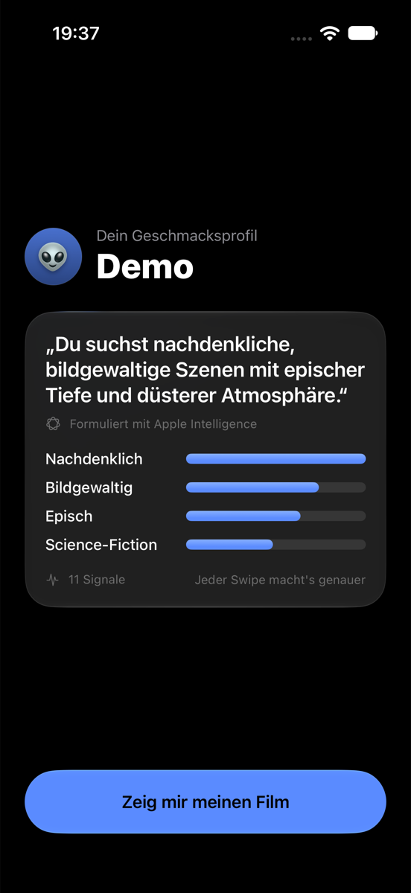
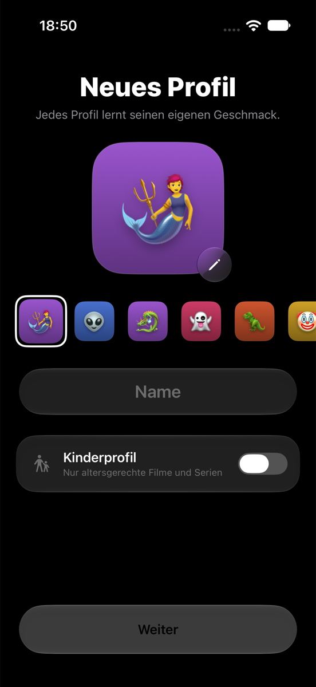

# Film

Ein Film statt tausend Kacheln. Film lernt beim Wischen deinen Geschmack und schlägt dir genau einen Titel für heute vor.

<p>
  
  
  
</p>

## Bauen

```bash
xcodegen generate
open Film.xcodeproj
```

Xcode 26, iOS 26 und tvOS 26. Das Team unter *Signing & Capabilities* einmal auswählen, dann ▶.

## Aufbau

- `App/`: iPhone- und iPad-App (SwiftUI)
- `TV/`: Apple-TV-App
- `Packages/FilmSync`: Abgleich zwischen Geräten
- `Packages/LightCode`: Anmeldung am Apple TV per Lichtcode
- `supabase/`: Konten, Geräte und Abos
- `Tests/`: Zustands- und Oberflächentests

Poster werden beim ersten Start geladen und nicht mitgeliefert. „Abspielen“ zeigt den offiziellen Trailer.
