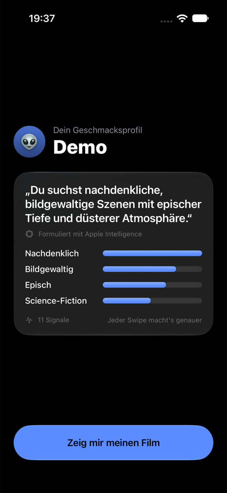
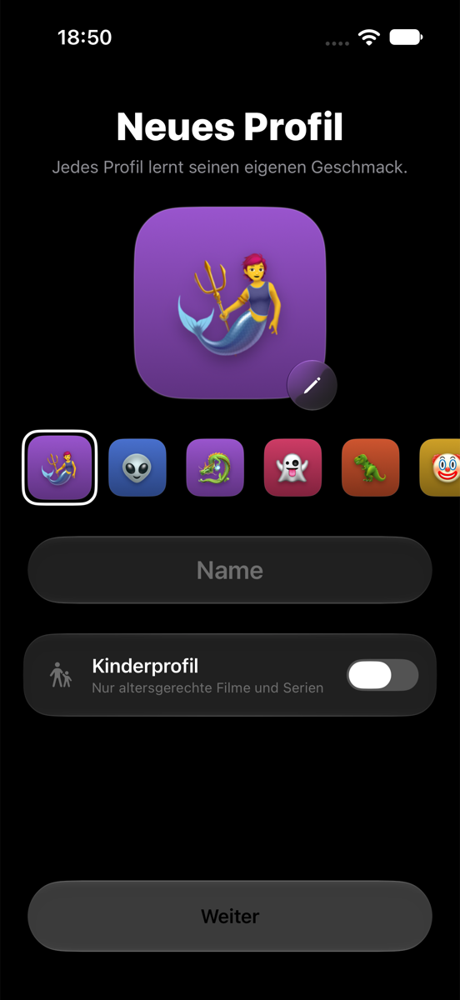
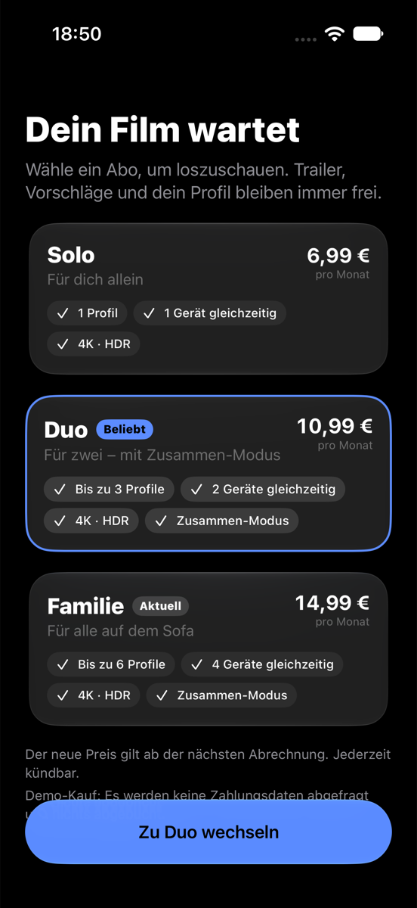

# Film

Ein Film statt tausend Kacheln. Film lernt beim Wischen deinen Geschmack und schlägt dir genau einen Titel für heute vor.

<p>
  
  
  
</p>

## Bauen

```bash
xcodegen generate
open Film.xcodeproj
```

Xcode 26, iOS 26 und tvOS 26. Das Team unter *Signing & Capabilities* einmal auswählen, dann ▶.

## Aufbau

- `App/`: iPhone- und iPad-App (SwiftUI)
- `TV/`: Apple-TV-App
- `Packages/FilmSync`: Abgleich zwischen Geräten
- `Packages/LightCode`: Anmeldung am Apple TV per Lichtcode
- `supabase/`: Konten, Geräte und Abos
- `Tests/`: Zustands- und Oberflächentests

Poster werden beim ersten Start geladen und nicht mitgeliefert. „Abspielen“ zeigt den offiziellen Trailer.

## Daten und Lizenzen

- Wertungen, Staffeln und Poster-Links: [OMDb API](https://www.omdbapi.com), CC BY-NC 4.0
- Empfehlungsmodell: [MovieLens](https://grouplens.org/datasets/movielens/), GroupLens Research. F. M. Harper, J. A. Konstan: *The MovieLens Datasets: History and Context*. ACM TiiS 5(4), 2015, [doi:10.1145/2827872](https://doi.org/10.1145/2827872). Mitgeliefert werden nur daraus abgeleitete Werte.
- Trailer von den offiziellen Studio-Kanälen auf YouTube, abgespielt mit [YouTubeKit](https://github.com/alexeichhorn/YouTubeKit) (MIT)

Nicht kommerzielles Studienprojekt. Filmtitel, Poster und Trailer gehören ihren Rechteinhabern.
